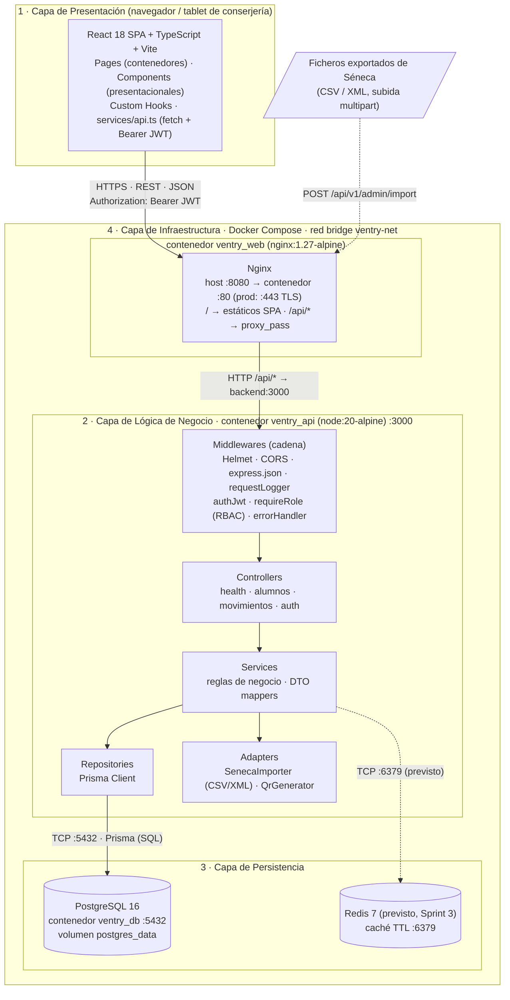
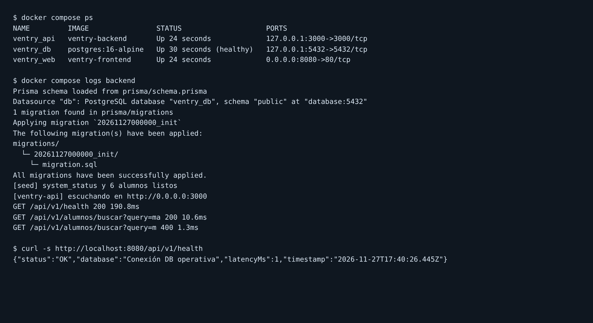
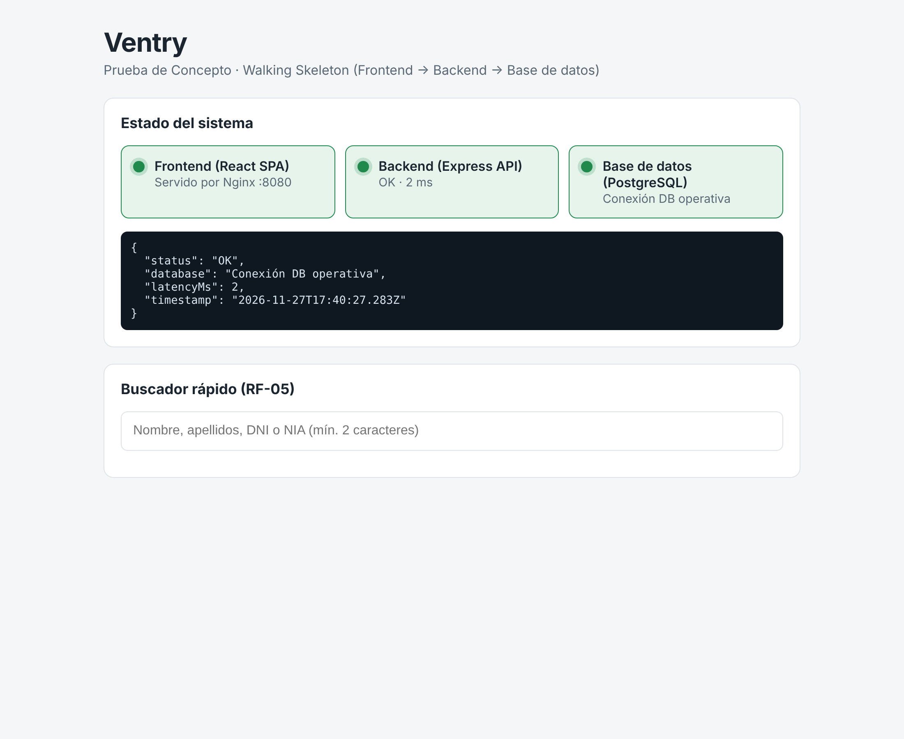
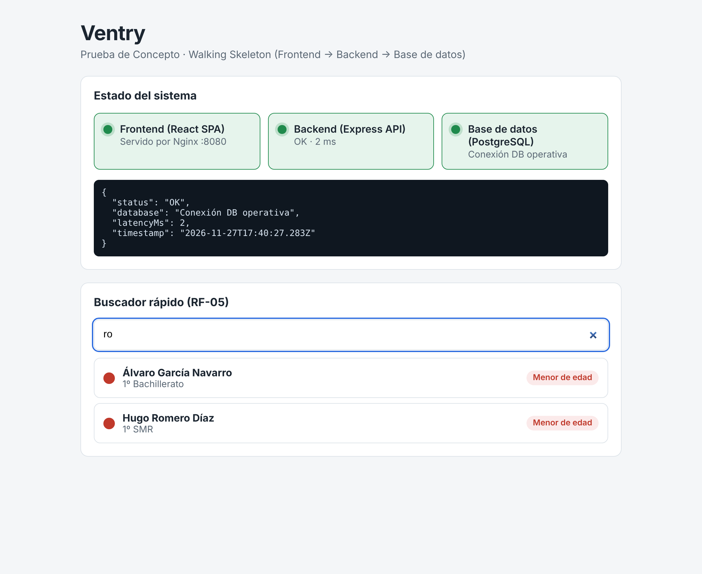

# Arquitectura del Sistema y Prueba de Concepto — VENTRY

**Proyecto:** VENTRY — Control de Acceso y Salida de Alumnado  
**Equipo:** Horsitos SL (2º DAW) — Nacher, Julián, José Javier y David  
**Entrega:** Sesión 8 · Arquitectura del Sistema y Prueba de Concepto (PoC)  
**Fecha:** 27/11/2026  
**Repositorio:** `https://github.com/nacherdev/Ventry`

---

## 1. Visión General de la Arquitectura

VENTRY sigue una **arquitectura desacoplada de 4 capas** con comunicación **REST + JSON** sin estado. Cada capa tiene una única responsabilidad y solo se comunica con la capa contigua a través de un contrato bien definido.

| Capa | Tecnología | Responsabilidad en VENTRY |
| :--- | :--- | :--- |
| **1 · Presentación** | React 18 + TypeScript + Vite, **SPA** (renderizado en cliente) | Interfaz Tablet-First de conserjería: buscador rápido, indicador Luz Verde / Luz Roja, lector QR, panel de dirección. Solo gestiona UI, UX y estado visual. |
| **2 · Lógica de negocio** | Node.js 20 + Express 4, API **REST** versionada (`/api/v1`), **JSON**, autenticación **JWT** (Bearer) + bcrypt | Validación de entradas, reglas de negocio (mayoría de edad, bloqueo de salidas de menores, RBAC), seguridad y orquestación del acceso a datos. Estructura interna *Controller → Service → Repository*. |
| **3 · Persistencia** | PostgreSQL 16 + **Prisma ORM** (migraciones versionadas). Auxiliares previstos: Redis (caché), volumen para fotografías, importación de ficheros de **Séneca** (CSV/XML) | Almacenamiento transaccional (ACID) del censo de alumnos, usuarios, movimientos de entrada/salida, observaciones y auditoría. |
| **4 · Infraestructura** | Docker + Docker Compose, red bridge `ventry-net`, **Nginx** como servidor estático y proxy inverso, volumen `postgres_data` | Empaquetado reproducible de cada capa en su contenedor, aislamiento de red y punto de entrada único (TLS en preproducción/producción). |

### Flujo de datos (petición típica: búsqueda de un alumno en conserjería)

1. El conserje escribe en el buscador de la SPA. El componente aplica *debouncing* (300 ms) y llama a la capa de servicios del frontend.
2. El navegador envía `GET /api/v1/alumnos/buscar?query=mar` con `Authorization: Bearer <JWT>` **al mismo origen** (Nginx, puerto 8080/443).
3. Nginx reenvía las rutas `/api/*` al contenedor `backend:3000` por la red interna `ventry-net`. Al ser mismo origen, **no hay peticiones CORS** en producción.
4. Express ejecuta la cadena de middlewares (Helmet → CORS → JSON → log → *authJwt* → *requireRole*) y llega al **Controller**, que valida parámetros.
5. El **Service** aplica las reglas (mínimo 2 caracteres, máximo 20 resultados, cálculo de mayoría de edad) y pide los datos al **Repository**.
6. El **Repository** ejecuta la consulta con Prisma sobre PostgreSQL (`database:5432`) usando índices.
7. El Service transforma las entidades en **DTO** (sin DNI, sin fecha de nacimiento, sin token QR) y el Controller responde `200 OK` en JSON.
8. React pinta la lista con el indicador Luz Verde / Luz Roja.

El servidor **no guarda sesión** en memoria: toda la información de identidad viaja en el JWT, por lo que cualquier réplica del backend puede atender cualquier petición.

---

## 2. Diagrama de Arquitectura



### Puertos, redes y protocolos

| Servicio (compose) | Contenedor | Imagen | Puerto interno | Puerto publicado en el host | Red |
| :--- | :--- | :--- | :---: | :--- | :--- |
| `frontend` | `ventry_web` | `nginx:1.27-alpine` (build multi-etapa) | 80 | `0.0.0.0:8080` (único punto de entrada) | `ventry-net` |
| `backend` | `ventry_api` | `node:20-alpine` | 3000 | `127.0.0.1:3000` (solo depuración local) | `ventry-net` |
| `database` | `ventry_db` | `postgres:16-alpine` | 5432 | `127.0.0.1:5432` (solo herramientas locales) | `ventry-net` |

| Tramo | Protocolo | Formato / seguridad |
| :--- | :--- | :--- |
| Navegador → Nginx | HTTP (local) / **HTTPS TLS 1.2-1.3** (preproducción y producción) | REST, JSON, cabecera `Authorization: Bearer <JWT>` |
| Nginx → Backend | HTTP interno por `ventry-net` (DNS de Docker: `backend`) | `X-Forwarded-For`, `X-Real-IP` |
| Backend → PostgreSQL | TCP 5432, protocolo de PostgreSQL vía Prisma | Credenciales desde `.env` (nunca en Git) |
| Backend → Redis (previsto) | TCP 6379 | Claves con TTL |

---

## 3. Patrones de Diseño Aplicados

### 3.1 Backend

#### P-01 · Arquitectura en capas (Controller → Service → Repository)
* **Problema en VENTRY:** las reglas de la mayoría de edad y del bloqueo de salidas de menores (RF-06, RF-09) son críticas a nivel legal. Si se mezclan con el código HTTP y con las consultas SQL, cualquier cambio en una ruta puede romper una regla RGPD sin que nadie lo note.
* **Implementación:** `src/controllers` solo lee `req` y escribe `res`; `src/services` contiene las reglas (`alumno.service.js`: mínimo 2 caracteres, máximo 20 resultados); `src/repositories` es la **única** carpeta que importa Prisma. Las dependencias van en un solo sentido.
* **Beneficio:** los servicios se prueban con un repositorio falso, y un cambio de motor de BD (por ejemplo, volver a MySQL) solo toca los repositorios y el `schema.prisma`.

#### P-02 · Repository
* **Problema en VENTRY:** la búsqueda por nombre/DNI/NIA se usará desde el buscador, el escáner QR y la importación de Séneca. Sin un punto único, cada módulo escribiría su propia consulta y los índices dejarían de aprovecharse.
* **Implementación:** `alumno.repository.js` expone `search(query, { skip, take })`, que construye el `where`, aplica proyección (`select`) y devuelve `{ items, total }` en una única transacción. En el MVP se añadirán `findByQrToken`, `upsertFromSeneca`, etc.

#### P-03 · DTO (Data Transfer Object)
* **Problema en VENTRY:** la tabla `alumnos` contiene datos personales de **menores** (DNI, fecha de nacimiento, fotografía, token QR). Devolver la entidad tal cual incumpliría RNF-03 (minimización de datos).
* **Implementación:** `dtos/alumno.dto.js → toAlumnoBusquedaDTO()` devuelve solo `id`, `nombreCompleto`, `curso`, `esMayorEdad` y `estado` (`VERDE`/`ROJO`). La edad se calcula en el servidor y la fecha de nacimiento nunca sale de la API. En el MVP habrá un `FichaAccesoAlumnoDTO` que incluirá foto y observaciones **solo** si el alumno es mayor de edad.

#### P-04 · Middleware / Cadena de Responsabilidad
* **Problema en VENTRY:** todas las rutas de conserjería deben exigir JWT válido y rol `ROLE_CONSERJE`; las de `/api/admin/**`, `ROLE_ADMIN` (RF-02). Repetir esa comprobación en cada controlador es propenso a olvidos.
* **Implementación:** `app.js` monta la cadena `helmet → cors → express.json → requestLogger → router → notFound → errorHandler`. En el Sprint 2 se insertan `authJwt` y `requireRole('ROLE_CONSERJE')` delante de los routers protegidos. `errorHandler` garantiza respuestas JSON homogéneas y que nunca se filtre una traza de error al cliente.

#### P-05 · Adapter
* **Problema en VENTRY:** el formato de exportación de Séneca (CSV/XML) es externo y puede cambiar entre cursos (riesgo RT-02).
* **Implementación prevista:** interfaz propia `AlumnoImporter` con adaptadores `SenecaCsvAdapter` y `SenecaXmlAdapter` que devuelven siempre `AlumnoImportDTO[]`. El servicio de importación (RF-03) no conoce el formato del fichero.

### 3.2 Frontend

#### P-06 · Contenedor / Presentacional
* **Problema en VENTRY:** el indicador Luz Verde / Luz Roja y la tarjeta del alumno se reutilizan en el buscador, en el escáner QR y en el histórico. Si cada uno hace su propio `fetch`, no se pueden reutilizar.
* **Implementación:** `pages/HealthPanel.tsx` y `pages/BuscadorAlumnos.tsx` (contenedores) obtienen datos con hooks; `components/StatusCard.tsx` y `components/AlumnoItem.tsx` (presentacionales) solo reciben *props* y pintan.

#### P-07 · Capa de servicios + Custom Hooks
* **Problema en VENTRY:** todas las peticiones deben llevar el JWT, gestionar el `401` (cerrar sesión) y, en RF-11, encolarse si no hay red.
* **Implementación:** `services/api.ts` es la **única** salida HTTP (`request<T>()` centraliza la URL base, cabeceras y errores). Los hooks `useHealth`, `useBuscarAlumnos` y `useDebounce` encapsulan estado, cancelación (`AbortController`) y *debouncing*. Las vistas no llaman a `fetch` directamente.

---

## 4. Estrategia de Rendimiento y Escalabilidad

Objetivo de referencia: **RNF-01**, el 95 % de las búsquedas y validaciones QR en **< 200 ms** con 2.500 alumnos y 20 peticiones concurrentes.

| # | Área | Medida | Aplicación concreta en VENTRY | Cómo se mide |
| :-: | :--- | :--- | :--- | :--- |
| R-01 | **Base de datos** | **Indexación** | Índices únicos en `nia`, `dni` y `qr_token` (búsqueda exacta y escaneo QR) e índice compuesto `(apellidos, nombre)` ya creados en la migración `20261127000000_init`. En el Sprint 2: extensión `pg_trgm` + `unaccent` con índice GIN para búsquedas parciales insensibles a tildes. | `EXPLAIN ANALYZE` debe mostrar *Index Scan* y < 5 ms por consulta con 2.500 filas. |
| R-02 | **Base de datos** | **Proyección y evitar N+1** | El repositorio usa `select` para leer solo las 5 columnas del DTO y `count` + `findMany` en una sola `$transaction`. Las fichas con observaciones usarán `include` (carga ansiosa / JOIN) en vez de una consulta por alumno. | Nº de consultas SQL por petición = 1-2 (log de Prisma). |
| R-03 | **API / Backend** | **Paginación obligatoria** | `GET /api/v1/alumnos/buscar?query=&page=&size=`: `size` se limita a **20** en el servicio (RF-05). Todos los listados (`/movimientos`, `/admin/users`) seguirán el mismo contrato `{ data, page, size, total }`. | Payload < 10 KB por respuesta. |
| R-04 | **API / Backend** | **Diseño stateless + escalado horizontal** | Autenticación por JWT, sin sesiones en memoria. Permite `docker compose up --scale backend=3` detrás de Nginx (`upstream`) en horas punta (cambios de clase, riesgo RT-06). | Prueba de carga con `autocannon` (20 conexiones): p95 < 200 ms. |
| R-05 | **API / Backend** | **Caché con TTL (Redis)** | Sprint 3: cachear la lista básica de alumnos del día y las observaciones vigentes (cambian como mucho una vez por semana, tras la importación de Séneca) con TTL de 10 min; se invalida al importar. | Ratio de aciertos de caché > 80 %. |
| R-06 | **Frontend** | **Debouncing + cancelación** | `useDebounce` (300 ms) evita una petición por tecla; `AbortController` cancela la petición anterior si el usuario sigue escribiendo. | Escribir «martinez» genera 1 petición en vez de 8. |
| R-07 | **Frontend** | **Code splitting / lazy loading y caché de estáticos** | Las rutas de administración y dashboard se cargarán con `React.lazy()` para que la tablet de conserjería solo descargue el buscador. Nginx sirve `/assets/*` con `Cache-Control: immutable` (1 año) y compresión gzip (bundle actual: 47,5 KB gzip). | Lighthouse Performance ≥ 90; bundle inicial < 100 KB gzip. |
| R-08 | **Frontend** | **Caché local offline** (RF-11 / RT-04) | IndexedDB con la lista básica del día y una cola de movimientos pendientes que se sincroniza al volver la red. | La app sigue operativa con la red cortada. |

---

## 5. Validación mediante Prueba de Concepto (PoC)

### 5.1 Objetivo

Validar de extremo a extremo que el stack elegido funciona en contenedores: **el navegador carga la SPA desde Nginx, la SPA llama a la API Express, la API consulta PostgreSQL a través de Prisma y el dato real vuelve a la pantalla**, sin errores de CORS ni de red. Además del `health`, la PoC incluye un primer corte vertical del buscador rápido (RF-05) para validar la capa de datos con una consulta real paginada.

### 5.2 Estructura de carpetas

```text
Ventry/
├── docker-compose.yml          # Orquesta database + backend + frontend en la red ventry-net
├── .env.example                # Plantilla de variables (el .env real está en .gitignore)
├── backend/                    # Capa 2 · Node.js 20 + Express + Prisma
│   ├── Dockerfile
│   ├── docker-entrypoint.sh    # prisma migrate deploy + seed + arranque
│   ├── package.json
│   ├── prisma/
│   │   ├── schema.prisma       # Modelos SystemStatus y Alumno
│   │   ├── migrations/20261127000000_init/migration.sql
│   │   └── seed.js             # Semilla: "Conexión DB operativa" + 6 alumnos ficticios
│   └── src/
│       ├── server.js           # Arranque y apagado ordenado
│       ├── app.js              # Cadena de middlewares
│       ├── config/             # env.js, prisma.js
│       ├── routes/             # index.js  (/api/v1)
│       ├── controllers/        # health, alumno
│       ├── services/           # health, alumno
│       ├── repositories/       # systemStatus, alumno
│       ├── dtos/               # alumno.dto.js
│       └── middlewares/        # errorHandler, requestLogger
├── frontend/                   # Capa 1 · React 18 + TypeScript + Vite
│   ├── Dockerfile              # Multi-etapa: build con Node → servir con Nginx
│   ├── nginx.conf              # Estáticos + proxy inverso /api → backend:3000
│   └── src/
│       ├── services/api.ts     # Capa de acceso a la API
│       ├── hooks/              # useHealth, useBuscarAlumnos, useDebounce
│       ├── components/         # StatusCard, AlumnoItem (presentacionales)
│       └── pages/              # HealthPanel, BuscadorAlumnos (contenedores)
└── DOCS/
    ├── ARCHITECTURE.md         # Este documento
    └── img/                    # Diagrama y capturas de la PoC
```

### 5.3 Flujo vertical implementado

| Elemento pedido | Implementación |
| :--- | :--- |
| Tabla de prueba + semilla | Tabla `system_status` (migración Prisma) con el registro «Conexión DB operativa» y tabla `alumnos` con 6 alumnos **ficticios** (`prisma/seed.js`). |
| Endpoint de verificación | `GET /api/v1/health` → consulta real `SELECT … FROM system_status ORDER BY id DESC LIMIT 1` y devuelve `{ status, database, latencyMs, timestamp }`. |
| Endpoint de negocio | `GET /api/v1/alumnos/buscar?query=ma` → búsqueda paginada (máx. 20) que devuelve DTOs con `estado: VERDE/ROJO`. `query` de menos de 2 caracteres → `400`. |
| Pantalla frontend | `http://localhost:8080`: tres indicadores (Frontend, Backend, Base de datos) que se ponen en **verde** al recibir el JSON, más el buscador con Luz Verde / Luz Roja. |

Ejemplo de respuesta real:

```json
{
  "status": "OK",
  "database": "Conexión DB operativa",
  "latencyMs": 2,
  "timestamp": "2026-11-27T17:40:27.283Z"
}
```

### 5.4 Instrucciones de arranque

Requisitos: Docker Desktop (o Docker Engine) con Docker Compose v2.

```bash
# 1. Clonar el repositorio y situarse en la rama de la PoC
git clone https://github.com/nacherdev/Ventry.git
cd Ventry
git checkout feat/poc-architecture

# 2. Crear el fichero de entorno a partir de la plantilla
cp .env.example .env          # en Windows PowerShell: copy .env.example .env

# 3. Construir y levantar los tres contenedores
docker compose up --build
```

Al arrancar, el backend aplica automáticamente las migraciones (`prisma migrate deploy`) y la semilla. Después:

| Qué comprobar | URL / comando |
| :--- | :--- |
| Pantalla de la PoC | <http://localhost:8080> |
| Health check a través de Nginx | `curl http://localhost:8080/api/v1/health` |
| Health check directo al backend | `curl http://localhost:3000/api/v1/health` |
| Búsqueda | `curl "http://localhost:8080/api/v1/alumnos/buscar?query=ma"` |
| Estado de los contenedores | `docker compose ps` |
| Reinicio limpio (borra la BD y la vuelve a sembrar, plan RT-05) | `docker compose down -v && docker compose up --build` |

### 5.5 Evidencias de funcionamiento

**Contenedores levantados, migración + semilla aplicadas y respuesta del health check:**



**Pantalla del frontend consumiendo `/api/v1/health` (los tres indicadores en verde con el dato leído de PostgreSQL):**



**Buscador rápido consultando la tabla `alumnos` (búsqueda «ro»: dos menores de edad con Luz Roja):**



En la consola del navegador no se registró **ningún error** de red ni de CORS: la SPA llama a `/api/v1/...` en su mismo origen y Nginx reenvía la petición al backend por la red interna.

### 5.6 Decisiones y cambios respecto a entregas anteriores

* **Stack definitivo:** Node.js + Express + Prisma + PostgreSQL, tal y como se eligió en la Sesión 4 y en la configuración Docker inicial del repositorio. La sección 1.4 y el RNF-05 del ERS (Hito 2) mencionan Spring Boot y MySQL; se actualizarán para reflejar este stack.
* **docker-compose.yml:** se pasa de PostgreSQL 15 a 16, se añaden el servicio `frontend`, la red `ventry-net`, un `healthcheck` de la BD (el backend espera a que esté lista) y los puertos de BD y API solo se publican en `127.0.0.1`.
* **Seguridad (RT-01):** las credenciales solo existen en `.env`, que está en `.gitignore`; el repositorio solo contiene `.env.example`.
